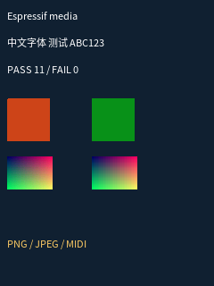

# Espressif 媒体组件实机验证

日期：2026-10-23。ESP32-S31-Korvo-1，240×320 Java 画面，6 MiB Java 堆，解释器模式；未安装 SD 卡，使用 Flash FAT。原列表 19 项仍在，本次追加 5 个诊断 JAR；烧录没有擦除 `j2me` 游戏与 RMS 分区。

最终应用为 5,543,248 字节，SHA-256：

```text
c2562c8ba1f499a41d3cf71320d194cd01a2ff369fe98e4a02b82e7a99a1dd08
```

ESP-IDF 为 `ab95e70748f2eddac6f87217b0cf62533684a6ba`。核心子模块为 `bdee0bf`，另含未提交的短 PCM 生命周期修复。应用写入 `0x10000`；esptool 完整哈希校验通过，五个镜像段头也经过读回比较。USB 重连后串口从 `/dev/ttyUSB0` 变成 `/dev/ttyUSB1`，后续通过 `/dev/serial/by-id` 连接。

## 实机结果

| 项目 | 结果 |
| --- | --- |
| RGBA PNG | 保留完全透明像素 |
| 调色板 PNG + tRNS | 像素正确返回 `0x8000ff00` |
| 奇数尺寸 baseline JPEG | 51×37，ARGB 不透明及颜色通道检查通过 |
| CMYK JPEG | 官方库拒绝后，核心软件解码回退成功 |
| WAV / MP3 / AAC | 600–650 ms 片段播放结束，Player 回到 PREFETCHED（300） |
| AMR-NB / AMR-WB | 官方解码器接受合成测试帧，600 ms 播放结束 |
| MIDI | C4/E4/G4，实际合成非零 PCM，播放位置约 749 ms |
| MIDI 控制 | 设置无限循环、停止、跳转到 200 ms、继续播放 |
| MIDI 连续循环 | 60 秒循环通过，输出 1,325,440 个样本，其中 1,325,199 个非零，峰值 11,999 |
| 4 ms 短 PCM | `SHORT_PCM_OK state=300 events=1`，结束事件恰好一次 |
| 字体 | 帧缓冲截图可见中文、英文和数字 |

`MediaBench` 返回 `pass=11 fail=0`。媒体夹具和短 PCM 夹具退出时 PSRAM 均从 **10,567,924 字节恢复为 10,567,924 字节**，`delta=0`。ES8389 codec 写入错误为 0。

最终一分钟循环期间，运行中可用 PSRAM 稳定在约 2694 KiB；音源关闭后升至约 2874 KiB，退出 MIDlet 后同样完整恢复为 10,567,924 字节。日志出现 `MIDI_AUDITION_OK`，codec 写入错误为 0。主动关闭 MIDI 时，输出回调通过失败返回值中断 SDK 合成，因此可能伴随 `MIDI.SYNTH: Output stream failed`；这次是正常取消路径。该轮队列耗尽计数为 1，包含片段结束过渡，不将它表述为零欠载或无缝播放认证。



这是帧缓冲截图。音频队列计数包括结束时的补零和队列耗尽，不能将 codec 写入成功或 Player 时间增长直接当作扬声器出声证据。用户已在 MIDI 试听期间确认“能听到 MIDI 了”；没有进行录音、频响或音质评测。上表最初的 AMR 项仅验证了合成帧的解码与播放流程，可听人声补测见下节。SF2 的转换路径经过宿主测试，本次板上使用内置音源。

## AMR 可听测试更正（同日补测）

用户反馈 AMR 无声后，独立检查发现旧夹具的 AMR-NB 解码后峰值及 RMS 都为 **0**，AMR-WB 峰值仅 **161**、RMS 约 **93**。零载荷测试帧不能证明扬声器出声。问题来自测试素材；这轮没有修改或重新烧录固件。

已将生成脚本中的零载荷替换为真实编码的 440 Hz 测试音，并增加人声 “Audio test. One, two, three.”。AMR-NB 使用 OpenCORE 12.2 kbit/s，AMR-WB 使用 VisualOn 23.85 kbit/s，DTX 关闭。构建 JAR 前用 ffmpeg 独立解码，检查这些应当有声的素材；原静音文件已确认会被检查拒绝。

| 人声素材 | 采样率 | 时长 | FFmpeg 解码峰值 | FFmpeg 解码 RMS |
| --- | --- | --- | --- | --- |
| AMR-NB | 8000 Hz | 2680 ms | 22429 | 2192.29 |
| AMR-WB | 16000 Hz | 2680 ms | 21991 | 2188.28 |

由于 Flash 可用空间接近 256 KiB 上传保留值，试听包以紧凑 MP3 作为人声对照，压缩至 **18,967 字节**，没有删除既有游戏或存档。`amr-audition.jar` 已上传为当时的列表索引 **24**，依次播放 MP3、AMR-NB、AMR-WB，重复四轮：

```text
AMR_AUDITION_DONE pass=12 fail=0
RUN_END rc=0 psram_before=10567924 psram_after=10567924 delta=0
AUDIO errors=0 volume=70
AUDIO_DETAIL accepted=430268 queued=0 underruns=0
```

每段播放均到达结尾并回到 PREFETCHED（300）；用户已明确确认“**两种 AMR 都能听到**”。板子最后返回菜单。旧 `espressif-media-bench*.jar` 的 AMR 资源仍是当时上传的静音素材，试听应选择 **AMR Audition**；新生成的 MediaBench 已包含有声测试音，但本轮因保留空间限制没有再上传另一份大包。

素材、编码文件哈希和重新生成方法见 [fixtures](../tests/media/fixtures/README.md)；本机日志为 `build-media/validation/amr-board-session.log`，结果截图为 `amr-audition-pass.png`。

## 实测发现与修复

### 《孤岛余生2时间之谜》标题音乐补测

使用板上已有游戏 `gffe21f751ac6.jar`（Glu 1.0.3，240×320），选择中文并明确选择开启音乐，未修改游戏或存档。实际标题音乐资源 `255` 为 3,509 字节、8 轨的 SMF 格式 1，第一轨只有 tempo 等信息；官方 SDK 只播放第一轨，原适配层因此输出零个样本。平台现在按绝对 tick 稳定合并各轨，输出 3,338 字节的格式 0；独立解析核对全部六个游戏 MIDI，事件及时间与原文件一致，标题曲保留 772 个事件、结束 tick 51,598。

多轨修复后又复现了约 4.4 秒便停止供数的问题。完全不调音量也会发生：线程快照显示卡在 `esp_midi_stream_delete` 内联的 `free_node`，Note Off 找不到活动音符时无界遍历循环池。已经耗尽有限采样的音符也会触发这一情况。现在通过链接包装该库的 Note Off 入口，并用每个合成任务独立的活动采样记录忽略无对应声音的关闭事件；正常声音仍由官方 RELEASE 路径释放，没有依赖私有结构偏移。

同时，游戏的 `Graphics.drawRGB()` 在音频采样占用、碎片化 PSRAM 时无法申请整张图的临时副本。核心增加仅在整图分配失败时使用的逐行回退，保留原正常路径；模拟碎片化内存的 LCDUI 回归确认负 stride 和目的行位置正确。LCDUI 三轮生命周期测试共 **3,162 项断言**通过，四组媒体 CTest 全部通过。

最终固件：`lostisland-final-app.bin`，SHA-256：

```text
5e91084a15d08df9f0988a21dabcdfd606c283485f0d5a5c2670926728229b4f
```

仅烧录应用分区，完整镜像校验与五个段头回读通过。播放中按 `80 → 60 → 0 → 70` 调整板级音量，供数继续增长，codec 错误为 0；完整标题曲输出 **1,146,729** 个样本，其中 **1,139,377** 个非零，峰值 **9,830**、平均绝对幅度 **3,299**，游戏 VolumeControl 为 30。最终标题测试未再出现绘图内存不足，退出正常，PSRAM 差值为 **0**。

此版本游戏在初始标题页调用的是单次播放，原曲约 **52.014 秒**，自然结束后静音符合游戏调用；平台遵守游戏的循环设置。短暂的开头休止也会使最早 200 ms 的 `MIDI_SIGNAL` 为零，应结合完整 `MIDI_PCM` 判断。内置波表仍保留前述音色及最长单音采样限制。

同一最终固件补跑 `AMR Audition`：MP3、AMR-NB、AMR-WB 各四轮，共 **12/12** 通过，退出 PSRAM 差值为 0。`MIDI Audition` 在调节音量后持续循环 60 秒，输出 **1,325,440** 个样本（**1,325,199** 个非零），报告 `MIDI_AUDITION_OK`；主动关闭时 SDK 的 `Output stream failed` 来自停止标志中断回调，属于取消播放路径，codec 输出错误仍为 0。

本机证据：`build-media/validation/lostisland-audio.log`、`lostisland-final-host-results.log`、`lostisland-merge-check.log`、`lostisland-final-title.png`。先前的静音和死循环复现也保留在同一串口日志中，应以最终固件 SHA-256 后的记录为准。

### 其他媒体路径

1. JPEG 默认返回 RGB565，而 MIDP 图像接收函数按 Java `int[]` 复制。平台适配默认改为 ARGB8888，保留显式请求原生像素格式的接口。
2. 短 PCM 在 `Player.start()` 中被设备全部接受后，没有进入帧泵，导致状态停留在 STARTED，也没有 `endOfMedia`。核心在 PCM 打开时始终注册帧泵；增加真实 Java PlayerListener 回归。
3. 内置 MIDI 单周期音源的采样率与官方混音器不一致，音符被静默跳过，输出只有用于计时的静音。现在在 note-on 回调返回前就按实际音高生成匹配采样率的 PCM，SF2 同样先完成音高和采样率转换。增加 `MIDI_SIGNAL` / `MIDI_PCM`，检查非零样本、峰值与平均绝对幅度。
4. 官方混音器不重复单周期采样；内置音源现在每音符生成最长 4 秒的有限采样。普通零力度 Note Off 使用 RELEASE 立即释放，避免 REDUCE 在这种事件下保持原音量。此音源提供基础声音，不是完整 GM 音色库。
5. SDK 在引擎关闭时可能不为仍在播放的音符调用 `free_data_cb`。平台独立追踪样本所有权，在音源卸载时回收残留，避免停止、跳转或退出时泄漏。

## 宿主回归与复现

ASan/UBSan 下三组 CTest 全部通过：适配层、短 PCM Java 生命周期、上游音频的 44 项检查。适配层覆盖真实 libpng 的 28 种颜色/位深/交错组合、FreeType、zlib，以及 JPEG/音频/MIDI SDK 接口替身。MIDI 测试检查非零波形、八度关系、44.1 kHz SF2 转换、部分写入、音量和中断时样本回收。

```sh
bash tools/idf.sh -B build-media build
python3 tools/build_media_fixture.py
bash third_party/nano_j2me/tools/make_audio_jar.sh "$PWD/build-media/validation/upstream-audiodemo.jar"
python3 third_party/nano_j2me/tests/gen_lcdui_fixture.py
cmake -S tests/media -B build-media-host -G Ninja -DCMAKE_BUILD_TYPE=Debug
cmake --build build-media-host -j 3
ctest --test-dir build-media-host --output-on-failure
```

用 IDF Python 运行 `tools/media_board_session.py --port PORT`，每行输入一个 JSON 动作。先 `list` 查对应索引；本次媒体、短 PCM 和 MIDI 试听分别为 20、22、23。MIDI 试听先播放 WAV 参考音，然后循环播放 60 秒 MIDI。应用烧录与测试使用同一个串口连接；增量烧录仍校验完整镜像。

```json
{"action":"command","text":"list","wait":1}
{"action":"run","text":"run 20","marker":"MEDIA_BENCH_DONE","seconds":45}
{"action":"command","text":"stop","wait":2}
{"action":"run","text":"run 22","marker":"RUN_END rc=0","seconds":10}
{"action":"run","text":"run 23","marker":"MIDI_AUDITION_BEGIN","seconds":15}
```

本机证据位于 `build-media/validation`：`final-board-session.log`、`midi-final-host-results.log`、`midi-final-app.bin` 和 `espressif-media-pass.png`。此前调试轮次的日志和测试 JAR 仍保留；应以最终日志和上述 SHA-256 为准。
