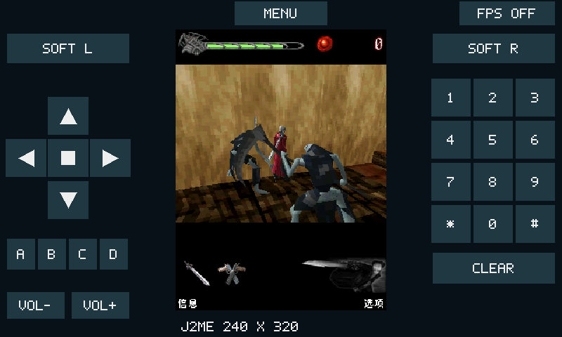
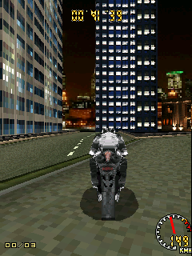

# fe974fc 更新与 240×320 实机回归

2026-10-22，ESP32-S31-Korvo-1，CPU 320 MHz、PSRAM 250 MHz，Java 堆 6 MiB，无 SD 卡。子模块从 `fed8d0c` 快进到 **`fe974fc7c29f462fdcbbcdcdb307cc7b2108d527`**，保留上游源码原样。新增提交包含 ARM64 JIT、Micro3D 模型/动画/光栅化，以及 RV32 JIT 探测成本优化。本板实际执行 RV32，ARM64 仅参加主机编码器测试。

所有游戏和基准固定 **240×320**。常规性能对照关闭 FPS、音量 40、无手动输入，每次使用新建的临时 RMS。只烧录应用，没有覆盖 FAT 游戏分区及正常存档。原始结果、校验值、ROM 哈希和固件标识见 [latest-results.json](latest-results.json)；旧版数据保留在 [UPSTREAM_GAMES.md](UPSTREAM_GAMES.md)。

## 固定工作量

以下为最终固件复跑数据，同一固件切换公开 JIT API。CPU、重绘各两轮平均；音频和赛车启动各一轮。时间包含加载、运行、显示和销毁。

| 测试 | JIT 关 | JIT 开 |
| --- | ---: | ---: |
| CPU 固定计算，120×4000 | 9.8564 s | 15.1198 s |
| 240 次完整重绘 | 8.0666 s | 8.0905 s |
| WAV + MIDI 播放夹具 | 11.6740 s | 11.5842 s |
| 极品飞车14，300 VM 帧启动 | 7.9333 s | 8.0801 s |
| 极品飞车16，300 VM 帧启动 | 14.5101 s | 16.1859 s |

CPU 端到端耗时增加约 **53%**，因此运行时 **JIT 仍默认关闭**，编译支持保留。重绘约 30 VM 帧/秒；赛车以上数据只覆盖启动，不代表赛道帧率。CPU 校验值均为 `-1082513742`；每项开关对照最终原始画面及 LCD 游戏区域 CRC 相同。

音频两种模式均完整完成 WAV 3.000000 秒、MIDI 3.139682 秒，接收 135,380 源 PCM 帧、输出 297,472 帧 48 kHz 立体声，驱动写入错误和欠载为 0。每组均有 1 次整文件首包的部分接收，运行器按返回值重试余下数据；`offered=193338` 含重试，不代表独立源帧数或丢帧。这里验证的是传输及播放进度，没有进行人工听音或麦克风音质评价。

## 隔离显示后的纯 Java 内核

`KernelBench` 直接调用子模块原始 `tests/jitperf/JitPerf.java`，不修改计算内核。每项先调用 0 次迭代完成初始化，再计时 50,000 次迭代。所有计时都在安装 Displayable 前完成，排除绘图、限帧和音频；结果输出也在计时之后。结束时安装空白 Canvas，以便正常退出和检查显示端回收。结果和独立桌面 JVM 的校验值一致。

每种模式两轮平均，单位毫秒：

| 内核 | 解释器 | 仅探测 probe | JIT | JIT 耗时变化 |
| --- | ---: | ---: | ---: | ---: |
| 局部变量 locals | 143.0 | 509.0 | 121.0 | -15.4% |
| 常量 constants | 110.5 | 307.0 | 116.5 | +5.4% |
| 字段 fields | 201.0 | 487.5 | 416.0 | +107.0% |
| 数组 arrays | 205.5 | 588.0 | 409.5 | +99.3% |
| 分支 branches | 204.5 | 644.5 | 256.0 | +25.2% |

这说明新 JIT 对适合的局部计算已有收益，但尚未带来普遍加速。`probe` 安装 JIT 并进行热点检查/分析，不生成、不执行机器码；它用于观察探测路径代价，不能直接用两列相减精确分摊每个函数耗时。每项仅重复两轮，计时精度为毫秒；未给出统计显著性或推广到所有游戏的结论。此夹具与原 CPU 夹具的 Java 线程栈分配位置也不同，不能横向换算绝对指令吞吐量。

新版本每轮 CPU 原生块由上一版的约 1.65 条 Java 指令增加到 **4.08 条**，编译次数从 2241 降为 11；本轮 CPU 代码驱逐为 0，内存拒绝为 0。说明之前提出的短块/编译震荡问题已有改善，但总代价仍未摊薄。极品飞车16 启动仍有 4140 次代码驱逐和 1069968 次热点条目驱逐，需要继续观察缓存冲突。

建议上游后续优先测试：候选 PC/负缓存快速路径和热点条目映射，减少解释器每次取指的查询；在保持异常、GC、调度契约的前提下扩展已解析字段、数组和有界分支，形成更长的有效块；对相同工作量分别测 code/site 缓存容量以及统计开关，报告元数据、可执行 RAM 和总耗时。不要仅依据原生块执行比例或 VM FPS 调整默认值。旧建议中探测/执行拆分、最小块长度、组相联缓存和栈顶寄存器缓存已由上游实现，不再当作缺失项。

## 真实 3D 游戏

三份原始 JAR 共 2,012,679 B。FAT 剩余空间不足，故通过可选 `KORVO_TEST_GAME_DIR` 嵌入应用，菜单追加 `[APP]` 项；没有重新分区或删除已有游戏。资源保留原始字节，SHA-256 在 JSON 中。本配置的只读数据会常驻 PSRAM，三个游戏及内核夹具使空闲 PSRAM 减少约 2 MiB；这是测试资源的开销。

下面是 JIT 关闭时的手动探索，包含等待、菜单和截图暂停，**累计 VM FPS/三角形数不是稳定实战帧率，也不是开关性能对照**。截图是板上帧缓冲导出，不是屏幕照片。

| 游戏 | 到达状态 | 渲染统计 | 观察与边界 |
| --- | --- | --- | --- |
| 鬼泣3D中文版 | 第一关房间、Dante 与敌人同屏，发送转向/攻击输入 | Micro3D 582,667 三角形 | 场景/人物绘制工作；尚未验证通关、存档和攻击命中判定；本次音频输出为 0 |
| 浴火银河 | 新游戏、3D 星空/小行星、带 Weiter 的对话界面 | Micro3D 435,835 三角形 | 对话显示 `null`，本轮尚未证明进入可操控飞行；有 PCM 输出 |
| 3D摩托赛车 | 赛道、车手、建筑、HUD；发送加速，速度及位置变化 | 62,258 三角形，10,280 次 M3G 调用 | 已实际进入赛车场景；有 PCM 输出，未验证完整比赛 |

三次均 `rc=0`、`scale_mismatch=0`、`hot_live=0`、PSRAM 差值 0、退出后 JIT 代码存活量 0。首次运行时游戏捕获的 RMS 缺失异常不等于崩溃。GOF 和摩托探索运行的欠载分别为 387 和 10，其中包含多次暂停 VM 导出截图；这些计数不能用来评价持续游玩音频质量，单独的无截图音频夹具结果见上。





手动复现：`list` 找到对应 `[APP]` 项，设置 `res 240 320`、`jit off`，用 `bench INDEX 0` 隔离正常存档。鬼泣通过左软键进入新游戏/难度/任务选择，FIRE 确认任务，左软键翻过说明后开始；方向使用 `key right down`/`up` 保持约 1.5 秒，FIRE 约 1 秒。摩托选择 English，右软键 Next，FIRE 进入比赛，按住 UP 约 2 秒加速。菜单页数和等待取决于当前状态，不能把这些探索步骤当作固定帧的确定性脚本。GOF 的 `null` 仍待单独定位；JAR 未查询语言系统属性，语言开关不是已证实的修复。

## 实际更新 FPS

在最终固件、240×320、JIT 关闭、FPS 叠加开启时，先预热 5 秒，再每秒读取一次现有 `fps` 诊断，共 20 次。采样期间不截图。这里统计游戏画面实际变化次数，不是 LCD 扫描频率或 VM 调度帧数；平均值是 20 个约半秒窗口读数的平均，并非整段累计帧数的精确平均。

| 场景 | 平均读数 | 中位数 | 范围 |
| --- | ---: | ---: | ---: |
| 3D摩托赛车，城市赛道保持 UP 加速 | 3.94 FPS | 3.9 FPS | 3.8–4.2 FPS |
| 鬼泣3D，第一关战斗房间保持 FIRE | 8.47 FPS | 8.4 FPS | 7.4–9.8 FPS |

采样数据随 JSON 保存；该结果不能推广到所有关卡或其他分辨率。

## 复现与集成检查

```sh
python tools/prepare_test_games.py /home/lucinhu/Documents/game-roms/jar --output build/test-games
bash tools/idf.sh -DKORVO_TEST_GAME_DIR="$PWD/build/test-games" build
bash tools/idf.sh -p /dev/ttyUSB0 -b 2000000 app-flash
python tools/benchmark.py build/latest-off.json --jit off
python tools/benchmark.py build/latest-on.json --jit on
python tools/benchmark.py build/kernels-off.json --only kernels --jit off
python tools/benchmark.py build/kernels-probe.json --only kernels --jit probe
python tools/benchmark.py build/kernels-on.json --only kernels --jit on
python tools/serial_console.py smoke
```

父仓库补齐新上游源文件清单，接入公开 probe API 与驱逐统计；测试 ROM 只读虚拟文件和 JIT 可执行 SRAM 接口均位于父仓库。`bench` 只清理本次成功创建的 RMS 目录。高速截图增加逐行 ACK 和小批次发送，并固定恢复请求的 115200 波特率，避免硬件分频读回值累积偏差。当前 USB-UART 的 2 Mbaud 完整截图仍偶发丢数据，主机工具检测到长度/握手错误后回退 115200，并按画面大小延长超时；回退的完整 LCD 截图约需 134 秒。截图会暂停 VM，不能在计时区间执行。

主机 ASan/UBSan、Werror 配置下，JIT/RV32/ARM64 编码器、生命周期、M3G、Micro3D 模型/动画/光栅化/命令、IO 和 RMS 共 **13 项测试全部通过**。板级缩放器的 1800 帧矩形 oracle 检查通过。主机编码器通过不代表 RV32 执行验证，生成代码实际执行由板上 JIT 计数与内核校验确认。

最初端到端基准固件 SHA-256：`df9fbffc4c51497fd0b35c34a603aa5faa8538395fe00e826891012ecde854d2`。修正夹具退出后的纯内核及上述手动游戏固件：`7ff2080c50e19e656c397885d58b553c7ee799afc5a3c31a29a85b08edb6ab87`。最终截图批次/临时目录保护修正的固件：`5be90dc756a9ae6a8a517dfcd274d2b451bd82e8458908ecbb7795655d9af327`，应用大小 `0x43e370`，8 MiB 应用分区剩余 47%。最终复跑结果单独保存在 JSON，避免混淆不同固件的测量。

最终固件复跑：14 次端到端测试、6 次纯内核测试、三轮启停及按键/指针烟雾检查全部通过；正常速率/高速 CRC 错误清理、重名/容量保护和截图握手超时恢复通过。针对截图行截断进行实机故障注入，自动回退 115200 后导出成功，随后三次高速缩略 LCD 截图与回退图片逐字节一致。完整 2 Mbaud 截图仍保留上述限制，不宣称全部高速传输可靠。

结束时设备处于菜单：240×320、音量 40、JIT 关闭，按用户的 FPS 查看请求将屏幕 FPS 开关保持开启；重启后仍默认关闭。菜单共有 22 项（含演示/诊断），FAT 剩余 397312 B。最后一次战斗退出后 PSRAM、热数据和可执行代码全部回收。
