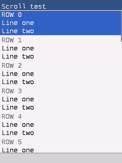
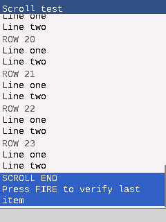
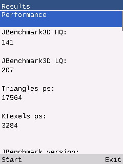

# 界面与 PPA 填充继续优化（2026-11-10）

后续 LCD 等待与重复帧优化见 [2026-11-11 记录](FRAME_PIPELINE.md)。

本轮以主仓库 `071e3a0`、核心 `6a13581` 为基线。核心新增 `04ed9aa`、`8689b5b`，均直接提交到 `lucinhu/nano_j2me` 的 `main`；主仓库继续通过 Git 子模块引用。最新固件已写入 `/dev/ttyUSB1`，只更新应用分区，游戏、RMS 和 NVS 保留。

## 矩形填充

上一版 PPA 填充主体后，每行右边的小段由 CPU 补齐，反复写 PSRAM 缓存行。现在把较大的边缘合并为第二个 PPA 窗口：逻辑行尾映射到描述符下一行的前缀，避开第一行前面的 VM 对象头；只有累计不少于 4 KiB 才额外提交。不能映射的末行、小边缘以及第二次提交被拒绝的情况由 CPU 完成。两个 GPU 操作均同步完成后才归还图像。

同一设备、240×320、MAX SIZE、JIT/FPS 关闭，使用原有未修改的 `FillBench`，每版两轮。均为 2,880 次填充，计时不含取像素、校验与最后显示。

| 指标 | 上一版 | 当前固件 |
| --- | ---: | ---: |
| Full，两轮 | 2,125 / 2,125 ms | 1,445 / 1,445 ms |
| Clipped，两轮 | 1,924 / 1,923 ms | 1,374 / 1,375 ms |
| 两项合计均值 | 4,048.5 ms | 2,819.5 ms |
| PPA 处理像素/轮 | 194,025,600 | 201,150,720 |
| CPU 补齐像素/轮 | 7,134,480 | 9,360 |

耗时减少 **30.36%**，本项吞吐提高 **43.59%**。四轮 Java 校验均为 Full `f4602800`、Clipped `05b483ec`，原生帧 CRC `e430c397`、LCD CRC `9a83e5df` 完全一致；退出 `rc=0`、PSRAM `delta=0`、缩放差异和热路径残留均为 0。数据见 [优化前](updates/2026-11-10-refinement/fill-before.json)、[最终固件](updates/2026-11-10-refinement/fill-after-final.json)。这项收益不代表所有游戏帧率提高相同比例。

启动资格检查从 64 个组合扩至 88 个，覆盖五种起点、RGB565/ARGB8888、Alpha 原值、边缘及末行，实机必须完全匹配才能启用。板级测试另覆盖带行尾 padding 的图像，以及第二个 PPA 请求失败后的 CPU 补齐，检查整个缓冲和哨兵。

## Form 菜单与结果页

核心修复如下：

- 每个 Form 单独记住滚动位置；上下移动时显示焦点，超长单项先分段滚动，末尾保持边界。
- 测量与绘制共用按宽度换行和 LF/CRLF 规则，标签、图片实际高度及首选高度参与布局。
- 内容限制在标题、软键栏之间，滚动条使用实际内容高度；触摸命中补偿滚动距离。
- 非交互 Gauge 不再拦截上下键或修改进度值。
- 内置 Form/List/TextBox/Alert 的背景和控件填充也继承可选硬件回调；未提供回调的移植沿用 CPU。

新加 `test_form_scroll` 通过公共 MIDP API 检查底部像素、超长多行内容、滚动后的触摸焦点、清空复位、进度条导航和三轮销毁后分配计数一致。初版回归在旧核心 `6a13581` 上因底部项目不可见而失败。最终核心的这项测试及 `test_lcdui`、`test_gfx`、`test_m3g_parallel` 共 4 项 ASan/UBSan 检查通过；板级适配 3 项检查通过。未据此宣称上游全套测试全部通过。

新增 `FormScrollDemo.java`，可用 `python3 tools/build_parallel_fixture.py --kind form` 构建，设备 Flash 安装为 `ui-form-scroll.jar`。实机验证 24 个多行条目可滚到底部，FIRE 能触发最后一项并正常退出，PSRAM 无漂移。启用控件硬件填充前后，两张截图的解码像素 SHA-256 完全相同，见 [记录](updates/2026-11-10-refinement/form-reference.json)。截图取自原生 VM 帧缓冲。

## 跑分与实机回归

JBenchmark 3D 本轮 **HQ 141 / LQ 207 / 17,564 triangles/s / 3,284 KTexels/s**，与上一版全开时的 HQ 141 / LQ 209 接近。3D 光栅器没有在本轮新增优化。HD 的长结果页现在能继续向下查看；原有 mipmap、深度精度和 Gaming 场景兼容问题仍然存在，不更改场景根对象顺序或得分判定。原始退出记录见 [benchmarks.json](updates/2026-11-10-refinement/benchmarks.json)。

HD 补测两轮：平滑三角形均为 **23,149/s**，纹理三角形 **21,937 / 21,935/s**；双线性检查 **90% / 91%**，透视精度 **99%**。向下滚动后确认 Fill rate 和 Gaming 都显示 **Failed**：日志分别记录双纹理单元不足和既有模型查找空引用，三线性检查记录 mipmap 不支持。HD 只部分完成，没有有效的 Fill rate 或 Gaming 分数。旧版历史记录来自更早的核心和加速配置，本轮不据此宣称 HD 性能提升。

跑分工具自动从当前设备列表发现 JBenchmark 索引，`--scroll-pages 5` 可追加结果截图，仍可通过 `--indices` 覆盖；只运行 HD 可加 `--suites hd`。HD 性能与后续功能信息的多页截图见 [输出目录](updates/2026-11-10-refinement/hd-results)。测试期间关闭 FPS，截图安排在计时结束后。

最终实机检查：启动 PPA 资格检查零差异；90 次显示更新零差异，DMA2D 提交/完成一致且无超时；双核 PSRAM 同步 300 轮零差异；Core 1 SIMD 128 轮、110,720 个 128 位块零差异。三轮演示退出内存稳定，FIRE、数字键和触摸指针通过，音频输出无错误。重启后设置完全恢复，七款指定游戏仍在列表中，Flash 剩余 **620 KiB**。

最终应用为 **7,944,496 字节**，SHA-256 `2eaa00b996334e08066bb526612f662f98b48f01a06298a4ae003fa68efaec2d`。设置恢复为 240×320、MAX SIZE、FPS 开、音量 40、JIT 关、mapped，双核/SIMD/PPA 开；Pixel Perfect 仍默认关闭。结构化汇总和最终设备检查见 [summary.json](updates/2026-11-10-refinement/summary.json)、[device-final.json](updates/2026-11-10-refinement/device-final.json)。

本轮另清理 **187.43 MiB、275 个文件**：临时宿主编译、旧版回归副本、重复适配测试构建、旧串口脚本、IDF 日志、生成的 PPM 与中间版本记录。保留当前固件构建、CMake 引用的游戏夹具、可复现测试 JAR、依赖、字体及原有 FAT 恢复文件。明细见 [cleanup.json](updates/2026-11-10-refinement/cleanup.json)。
